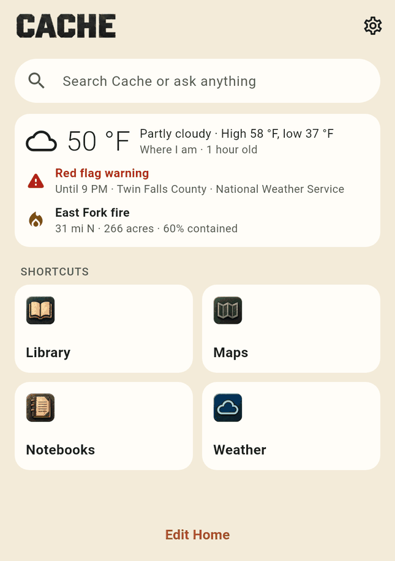
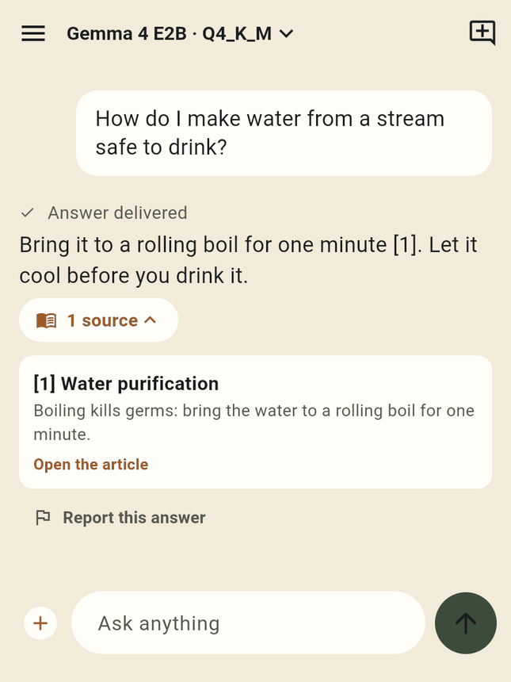
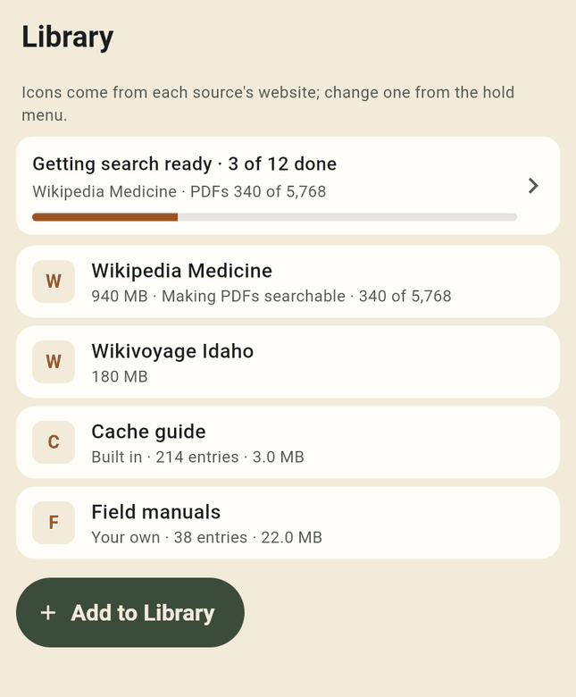
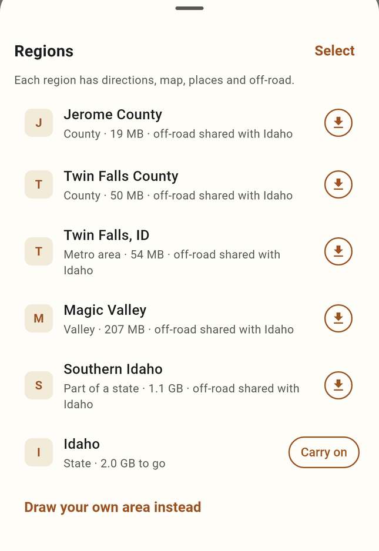
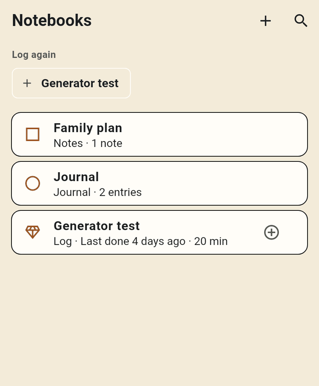
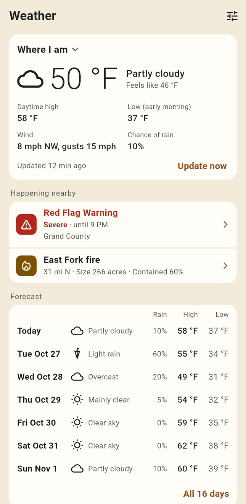

# Cache

Cache is an offline survival and preparedness app for Android and iPhone. It puts an assistant, a reference library, maps with
turn-by-turn directions, weather and alerts, and your own notebooks on the phone, and keeps them working with no connection.
The assistant runs on the device with a local language model and answers from what you have downloaded, with citations you can
open. Nothing depends on anyone's servers: there is no account, no sign-in and no Cache server in the middle, and what you keep
stays on your device. Cache is a framework. No data or models ship inside the app: you choose the models, libraries, regions
and sources you want, and Cache uses them offline.

Website: [cached.info](https://cached.info)

<p>
  
  
  
  
  
  
</p>

## What it does (1.0.30)

**Ask, on the device**
- A local language model (llama.cpp) answers questions from your Library, libraries, notebooks, downloaded places and maps,
  and weather data. Answers show numbered sources; a source opens the article, the PDF page, the EPUB chapter or the moment in
  a video.
- Pick a recommended model with its size and whether it fits your phone, search Hugging Face, or use a model file you already
  have.
- The assistant can save places, add notebook entries, watch places for weather and start navigation, only after you tap
  to confirm.
- A model is optional. With none, Cache is search only: Library, Notebooks, Places, Maps and the guide still work, and saved
  chats stay readable.
- Web search is optional and off unless you add a Kagi key and turn it on.

**Library**
- Kiwix ZIMs (Wikipedia, Wikivoyage and the rest of Kiwix's collections), downloaded inside the app, with pause and resume.
- Your own libraries from a file or a link, with update checks and a blank template to build one
  ([format](docs/LIBRARY-FORMAT.md)).
- Search reaches inside the PDFs, EPUBs and video captions in your ZIMs. Cache indexes them in the background, easing off when
  the battery is low or the phone is warm.
- A built-in PDF reader with find, go to page and dark pages.
- The Cache guide is built in, readable like a book and searchable by the assistant.

**Maps and directions**
- Download regions for offline maps, road routing, and place and address search.
- Turn-by-turn directions by car, on foot or by bike, offline, with spoken guidance and up to 10 stops.
- Off-road directions on foot or by vehicle where the region includes off-road data, with a land-access choice.
- Press and hold the map for To here, From here, Add stop, Save and Measure.
- Import places from KML, KMZ, GPX or GeoJSON, and repeater lists from RepeaterBook KML or CHIRP CSV; export as KML or GPX.

**Weather and alerts**
- Forecasts, weather alerts, FEMA IPAWS emergency alerts, wildfires, satellite fire hotspots, earthquakes, river levels, space
  weather and more, for your location and the places you watch. Each source is switched on separately; several of them are
  US services, and some need a free key. These update when a connection is available and are kept for offline use.

**Notebooks**
- A Journal, logs (with 16 starters), notes and a Places notebook. Entries can have a title, Markdown text, a date, a place,
  photos and documents.
- Keep notebooks in an Obsidian vault or a Logseq graph, and import notes tagged `#cachesync`.

**Videos**
- Add video sites (PeerTube first), search them, save videos for offline, and play them with captions, quality choice, resume
  and a transcript. Saved videos are searchable by what is said in them.

**Your devices**
- Sharing and sync links your own devices directly (iroh), with no Cache server. You choose what is shared: Library, Maps,
  Models, Videos, Notebooks and a shared folder. Search indexes built on one device are used by the others.
- Layouts for phones, tablets (two panes) and wide windows.

The full user guide is in [docs/guide](docs/guide/ch1.md).

## Get it

Cache is in testing.

- **Android:** Google Play testing. Join links coming soon.
- **iPhone:** TestFlight. Join links coming soon.
- **Android APK for sideloading:** coming in [GitHub Releases](https://github.com/zvx-echo6/cache/releases).

Android 9 (API 28) or later on a 64-bit (arm64) phone, or iOS 16.3 or later.

A Linux Cache Server (including Raspberry Pi) is planned for 1.1.

## Build from source

The release builds run in GitHub Actions: [android-play.yml](.github/workflows/android-play.yml) and
[ios-testflight.yml](.github/workflows/ios-testflight.yml). Those files are the full, current recipe. The steps below follow
them.

Toolchains used by CI: Flutter 3.44.8 (stable), Rust 1.99.1, Android NDK 28.2.13676358, cargo-ndk 4.1.2, Java 21.

```sh
git clone --recurse-submodules https://github.com/zvx-echo6/cache.git
cd cache
```

The `--recurse-submodules` flag brings in llama.cpp (`packages/cache_llama/third_party/llama.cpp`).

### Tests

```sh
# Rust core
cd packages/cache_search/native
cargo test --workspace --locked

# App and plugin
cd ../../../app
flutter pub get
flutter analyze
flutter test
cd ../packages/cache_search
flutter pub get
flutter test
```

The app tests use fakes for the native core, so they need no native build.

### Android

On a Linux host, with `ANDROID_NDK_HOME` pointing at NDK 28.2.13676358:

```sh
# 1. Routing: Valhalla 3.7.0 and its shim, for arm64-v8a (the first build takes a while; downloads stay in the work folder)
bash packages/valhalla/scripts/build-android.sh /path/to/valhalla-work /path/to/routing-out
mkdir -p app/android/app/src/main/jniLibs/arm64-v8a
cp /path/to/routing-out/libvalhalla_shim.so app/android/app/src/main/jniLibs/arm64-v8a/

# 2. Rust for Android and cargo-ndk
rustup target add aarch64-linux-android
cargo install cargo-ndk --version 4.1.2 --locked

# 3. The app. Gradle builds the Rust core with cargo-ndk, builds llama.cpp with the NDK, and fetches
#    Kiwix's prebuilt libzim into a folder outside the repository (CACHE_LIBZIM_BUILD_DIR, default ~/.cache/cache-libzim).
cd app
flutter pub get
flutter build apk --release
```

Without `app/android/key.properties`, release builds are signed with the debug key. For the emulator, add
`-PcacheSearchAbis=arm64-v8a,x86_64` to the Gradle command line. More detail:
[packages/cache_search/README.md](packages/cache_search/README.md), [packages/valhalla/BUILD.md](packages/valhalla/BUILD.md),
[packages/cache_search/native/zimx/LIBZIM.md](packages/cache_search/native/zimx/LIBZIM.md).

### iPhone

On a Mac with Xcode, CMake, Ninja and the `aarch64-apple-ios` Rust target:

```sh
packages/cache_search/ios/build-core.sh /path/to/libzim-work   # Rust core, Kiwix CoreKiwix, Valhalla
packages/cache_llama/ios/build-native.sh /path/to/llama-build  # llama.cpp with Metal
cd app
flutter pub get
flutter build ios --release
```

Signing for a device or TestFlight needs your own Apple team and profile. See
[docs/IOS_BUILD_PREFLIGHT.md](docs/IOS_BUILD_PREFLIGHT.md).

## Project layout

| Path | What |
|---|---|
| `app/` | The Flutter app (Android and iOS): screens, settings, the built-in guide and its screenshots, tests |
| `packages/cache_search/` | The core: a Rust workspace (`native/`) behind a C ABI, used from Dart over FFI. Search, libraries, places, regions, routing, off-road, live data, notebooks, videos, sync |
| `packages/cache_llama/` | The on-device chat engine over llama.cpp (submodule) |
| `packages/valhalla/` | Valhalla 3.7.0 build scripts and a small C shim for offline routing |
| `packages/cache_chunk/`, `packages/cache_classify/` | Text chunking and the classifier used in building libraries |
| `tools/guide/` | Builds and checks the user guide and its screenshots |
| `tools/classifier/` | Makes the classifier model and its test fixture |
| `docs/` | Design notes and formats; `docs/guide/` is the user guide |
| `assets/brand/` | Source artwork for the icons, splash and module tiles |
| `.github/workflows/` | Tests, guide checks, Android (Google Play) and iPhone (TestFlight) builds |

## Contributing

Outside contributions are not open yet; bug reports and suggestions are welcome in [Issues](https://github.com/zvx-echo6/cache/issues).

## Privacy

- No analytics, no crash reporting and no tracking. The app includes no telemetry SDK.
- No account or sign-in. Chats, notebooks, places, settings, downloads and search indexes stay on the device. Keys are kept in
  the device's secure storage (Android Keystore or iOS Keychain).
- The assistant runs on the device. Your questions are not sent anywhere to be answered.
- Cache goes online only for what you turn on or start: the data sources you switch on (with the coordinates of the places they
  watch), web search if you set it up, map layers that stream, downloads you start, video sites you add, place search for an
  area you have not downloaded (which sends only a roughly 100 km square), the lists it reads (regions, sources, layers,
  recommended models) and the new-version check.
- Sharing and sync, if you set it up, connects only your own linked devices. Devices find each other on the local network and
  over the internet (iroh's public lookup and relays); what they send is encrypted end to end, so a relay cannot read it.

The details are in [the guide's Privacy chapter](docs/guide/ch7.md).

## Licence

Cache is free software under the GNU Affero General Public License, version 3 or (at your option) any later version.
Copyright (C) 2026 Happy Little LLC. The full text is in [LICENSE](LICENSE). Third-party libraries, data and artwork keep their
own licences; they are listed in [CREDITS.md](CREDITS.md).
